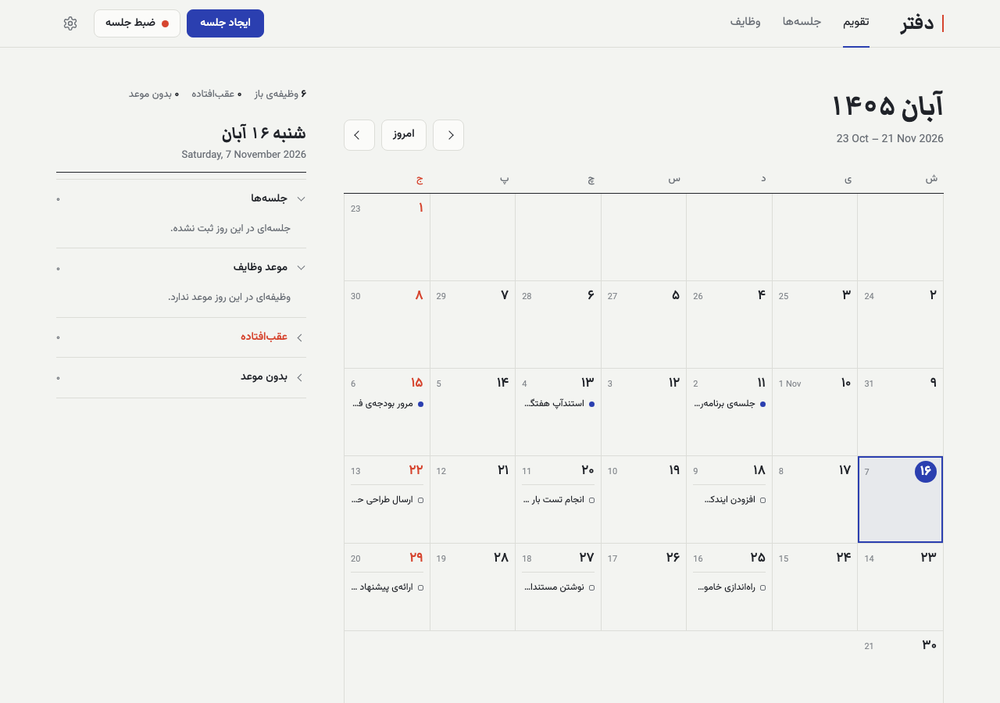
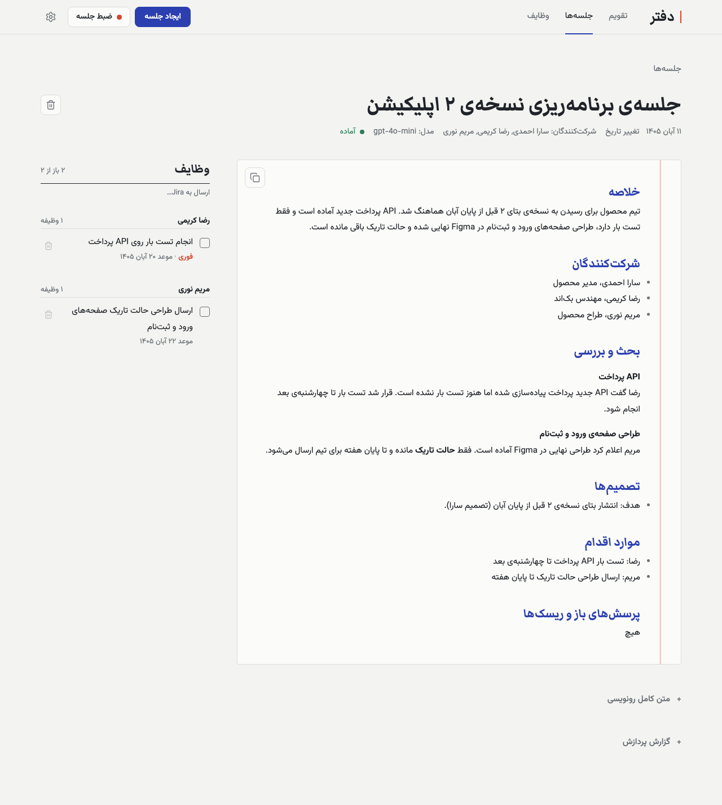
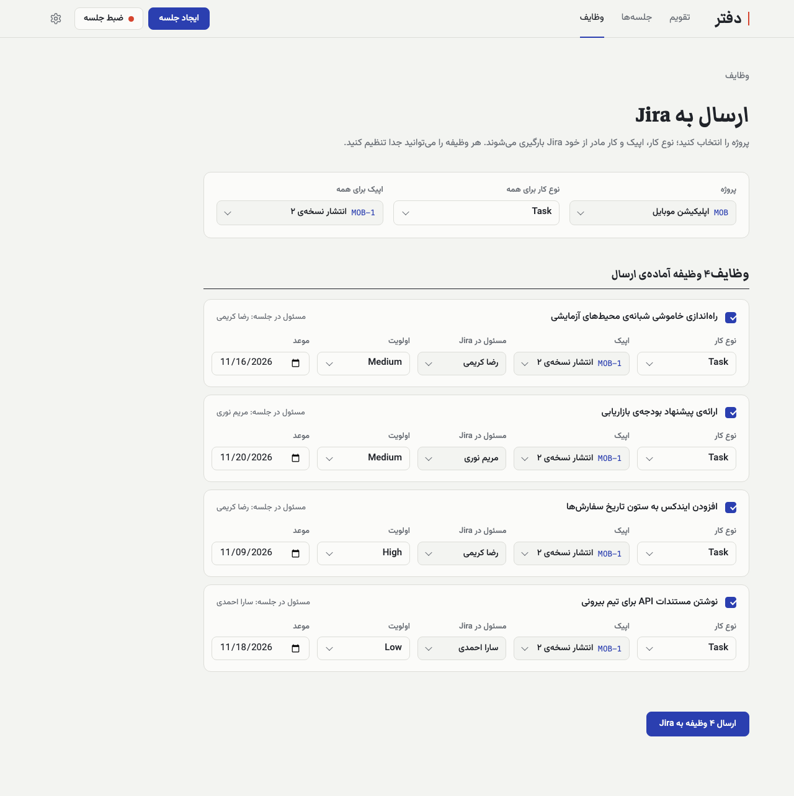
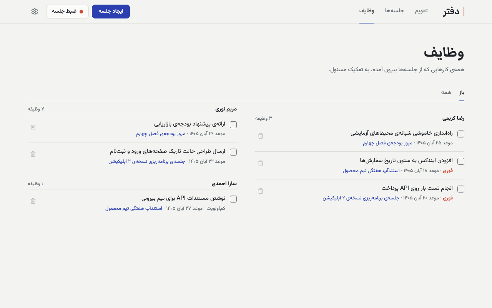
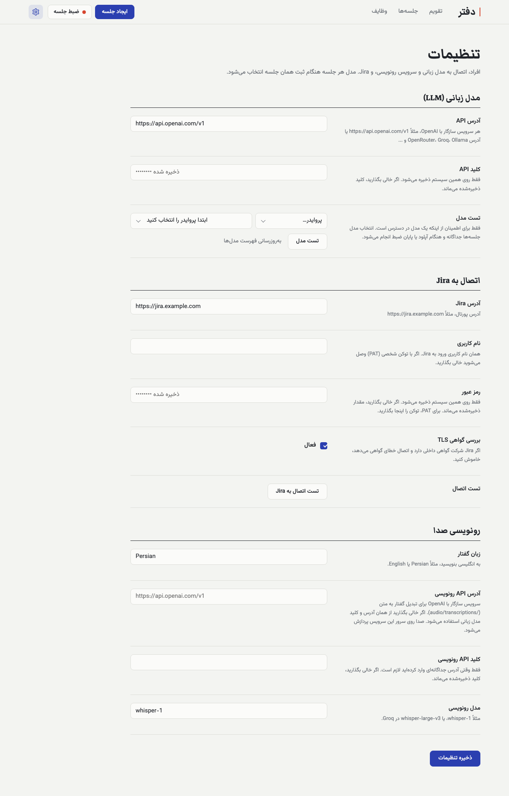
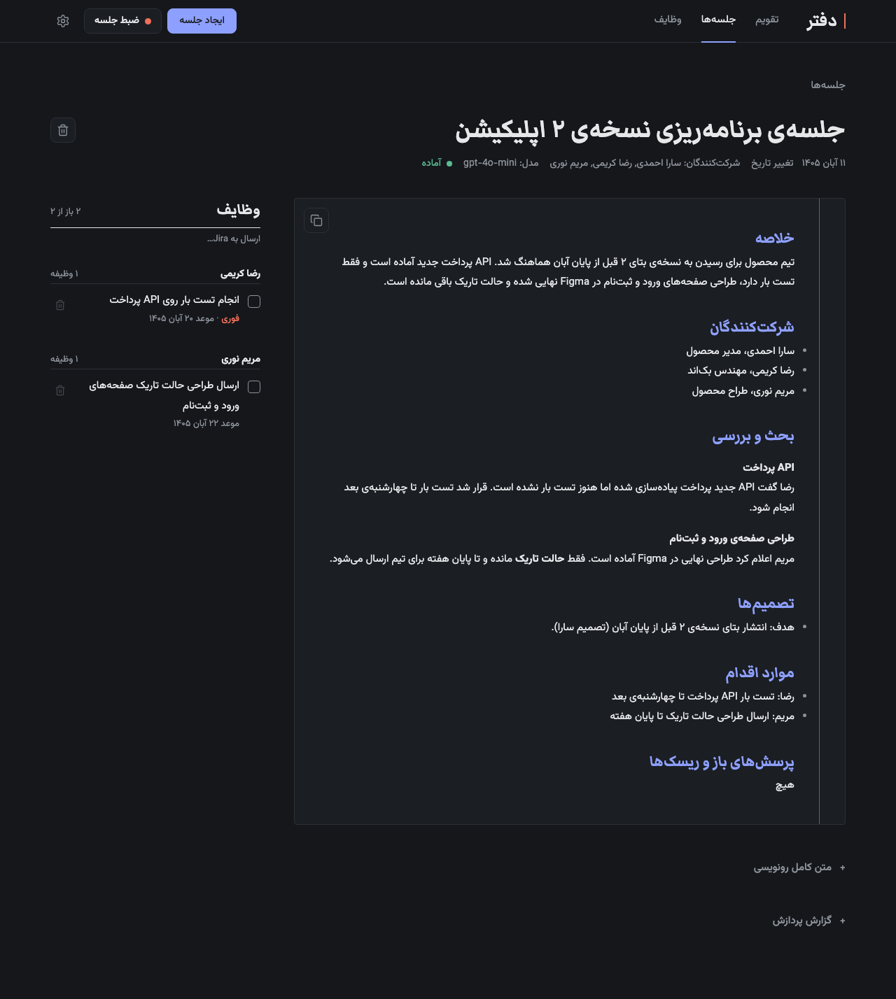
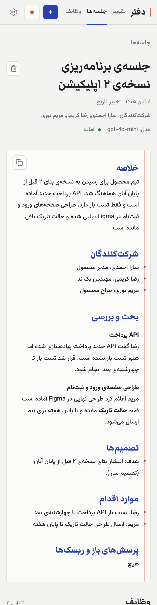

<div dir="rtl" align="right">

# دفتر (Daftar)

**دستیار جلسه‌ی خودمیزبان.** فایل صوتی یک جلسه را بدهید، یا جلسه‌ی حضوری را مستقیم از مرورگر ضبط کنید. دفتر آن را به رونوشت، صورت‌جلسه‌ی کامل و وظایف به سبک Jira تبدیل می‌کند. وظایف روی تقویم شمسی/میلادی می‌نشینند و با یک کلیک به Jira می‌روند.

[English](README.md) · فارسی

رابط کاربری فارسی و راست‌به‌چپ است. رونوشت و صورت‌جلسه به زبان صدای ضبط‌شده نوشته می‌شوند، پس زبان‌های دیگر هم کار می‌کنند.

</div>



<div dir="rtl" align="right">

## چه کار می‌کند

- **صدا به رونوشت.** فایل صوتی یا تصویری را بارگذاری کنید، یا با میکروفن ضبط کنید. صدا هنگام ضبط به سرور می‌رود، پس بستن تب فقط چند ثانیه‌ی آخر را از بین می‌برد. فایل‌های بلند فشرده می‌شوند، در جای سکوت بخش می‌شوند و بخش‌به‌بخش رونویسی می‌شوند. بخش‌های بی‌صدا ارسال نمی‌شوند.
- **صورت‌جلسه و وظایف.** مدل زبانی صورت‌جلسه‌ی ساخت‌یافته می‌نویسد (خلاصه، شرکت‌کنندگان، بحث، تصمیم‌ها، اقدام‌ها، پرسش‌های باز) و وظایف را به شکل تیکت قابل‌ویرایش بیرون می‌کشد: عنوان، توضیح Markdown، مسئول، اولویت و موعد. موعدهای نسبی مثل «چهارشنبه‌ی بعد» با تاریخ خود جلسه محاسبه می‌شوند.
- **فهرست افراد.** نام‌های مستعار را معرفی کنید تا «سارا» در صورت‌جلسه و وظایف به «سارا احمدی» تبدیل شود.
- **تقویم.** جلسه‌ها و موعد وظایف روی تقویم شمسی، همراه با تاریخ میلادی.
- **ارسال به Jira.** پروژه را انتخاب کنید؛ نوع کار، اپیک و کار مادر از خود Jira (نسخه‌ی Server / Data Center) بارگیری می‌شوند. هر وظیفه نوع، اپیک یا مادر، مسئول، اولویت و موعد خودش را دارد. نتیجه برای هر وظیفه جدا گزارش می‌شود و شکست یک وظیفه جلوی بقیه را نمی‌گیرد.
- **سرویس‌های خودتان.** برای مدل زبانی و تبدیل گفتار به متن، هر API سازگار با OpenAI را می‌توانید وصل کنید. به هیچ شرکتی وابسته نیست.

| صورت‌جلسه و وظایف | ارسال وظایف به Jira |
|---|---|
|  |  |

<details>
<summary>تصویرهای بیشتر: همه‌ی وظایف، تنظیمات، حالت تاریک، موبایل</summary>







</details>

جلسه‌های داخل تصویرها ساختگی‌اند.

## شروع سریع

به Docker و یک کلید API برای مدل زبانی و برای تبدیل گفتار به متن نیاز دارید (مثلاً یک کلید OpenAI هر دو را پوشش می‌دهد).

</div>

```bash
git clone <this repository>
cd daftar
cp .env.example .env     # اختیاری: کلیدها را اینجا بگذارید، یا بعداً در خود برنامه وارد کنید
docker compose up -d --build
```

<div dir="rtl" align="right">

آدرس <http://localhost:8787> را باز کنید و به **تنظیمات** (آیکن چرخ‌دنده) بروید:

۱. **مدل زبانی (LLM):** آدرس API و کلید را وارد کنید و «تست مدل» را بزنید.
۲. **رونویسی صدا:** آدرس را خالی بگذارید تا از همان سرویس مدل زبانی استفاده شود، یا آدرس دیگری بدهید. مدل (پیش‌فرض `whisper-1`) و زبان گفتار را تنظیم کنید.
۳. در صورت نیاز تیم‌تان را در بخش **افراد** و Jira را در بخش **Jira** وارد کنید.

به‌جای آدرس IP دستگاه از `localhost` استفاده کنید: مرورگرها فقط روی `localhost` یا HTTPS اجازه‌ی میکروفن می‌دهند.

بعد «ایجاد جلسه» (بارگذاری) یا «ضبط جلسه» را بزنید، برای آن جلسه یک مدل انتخاب کنید و منتظر صورت‌جلسه بمانید.

### نمونه‌ی سرویس‌ها

</div>

| کاربرد | آدرس API | مدل |
|---|---|---|
| OpenAI (مدل زبانی و رونویسی) | `https://api.openai.com/v1` | هر مدل چت؛ برای رونویسی `whisper-1` |
| رونویسی Groq | `https://api.groq.com/openai/v1` | `whisper-large-v3` |
| مدل زبانی OpenRouter | `https://openrouter.ai/api/v1` | هر مدل فهرست‌شده |
| مدل زبانی محلی با Ollama | `http://host.docker.internal:11434/v1` | مدلی که دانلود کرده‌اید |
| سرور Whisper محلی | آدرس `/v1` همان سرور، مثلاً `http://host.docker.internal:8000/v1` | نام مدلی که ارائه می‌کند |

<div dir="rtl" align="right">

هر سروری که `POST /chat/completions`، `GET /models` و `POST /audio/transcriptions` را با قالب OpenAI پیاده کند کار می‌کند. اگر مدل زبانی و رونویسی از دو سرویس مختلف می‌آیند، هر دو بخش تنظیمات را پر کنید. کلید هر سرویس هرگز به سرویس دیگر فرستاده نمی‌شود.

فایل `.env` فقط مقدارهای پیش‌فرض می‌دهد (`LLM_BASE_URL`، `LLM_API_KEY`، `STT_BASE_URL`، `STT_API_KEY`، `STT_MODEL`). بعد از ذخیره‌ی صفحه‌ی تنظیمات، مقدارهای ذخیره‌شده اولویت دارند.

## Jira

دفتر از طریق REST API نسخه‌ی ۲ با Jira Server / Data Center حرف می‌زند و توضیحات را با قالب wiki markup خود Jira می‌نویسد. Jira Cloud هنوز پشتیبانی نمی‌شود.

در تنظیمات آدرس Jira را با نام کاربری و رمز وارد کنید، یا نام کاربری را خالی بگذارید و توکن شخصی (PAT) را در کادر رمز بگذارید. هنگام ارسال، تیکت‌ها یکی‌یکی ساخته می‌شوند و ساخت هیچ تیکتی خودکار تکرار نمی‌شود، پس تیکت تکراری پیدا نمی‌شود. اپیک‌ها با Agile API وصل می‌شوند. اگر پروژه فیلد اجباریِ سفارشی دارد، خطای Jira کنار همان وظیفه نشان داده می‌شود.

## داده، حریم خصوصی و امنیت

- همه‌چیز محلی در پوشه‌ی `app-data/` ذخیره می‌شود (SQLite، و صدا تا وقتی در حال پردازش است؛ بعد از ذخیره‌ی رونوشت صدا پاک می‌شود). اگر جلسه‌ها برایتان مهم‌اند از این پوشه نسخه‌ی پشتیبان بگیرید: پشتیبان‌گیری خودکار وجود ندارد.
- **صدای شما برای سرویس رونویسی‌تان و رونوشت‌ها برای سرویس مدل زبانی‌تان فرستاده می‌شوند.** سرویس‌ها را با همین در نظر انتخاب کنید، یا هر دو را به یک سرور محلی وصل کنید.
- کلیدهای API و رمز Jira در پایگاه‌داده‌ی محلی ذخیره می‌شوند. هرگز از API برگردانده یا لاگ نمی‌شوند.
- **ورود (لاگین) وجود ندارد.** کانتینر فقط روی `127.0.0.1` گوش می‌دهد. بدون گذاشتن احراز هویت جلوی آن، به اینترنت بازش نکنید.
- مرورگر فونت‌های Google Fonts و دو کتابخانه‌ی کوچک (marked و DOMPurify) را از CDN عمومی بارگیری می‌کند.

## محدودیت‌ها

- API های استاندارد رونویسی گوینده‌ها را جدا نمی‌کنند، پس رونوشت خط‌های «Speaker 1 / Speaker 2» ندارد. مدل زبانی با کمک نام‌ها و بافت گفتگو جمله‌ها را به افراد نسبت می‌دهد.
- هر خروجی از کل رونوشت در یک درخواست ساخته می‌شود، پس جلسه‌های خیلی طولانی مدلی با پنجره‌ی زمینه‌ی بزرگ می‌خواهند.
- Jira Cloud پشتیبانی نمی‌شود.

## توسعه

</div>

```bash
docker compose build app
docker compose run --rm --no-deps app python test_app.py
```

<div dir="rtl" align="right">

تست‌ها بدون اینترنت اجرا می‌شوند: همه‌ی فراخوانی‌های شبکه (رونویسی، مدل زبانی، Jira) ساختگی‌اند.

</div>

| مسیر | کاربرد |
|---|---|
| `app/server.py` | مسیرهای FastAPI و پایپ‌لاین کارهای پس‌زمینه |
| `app/transcribe.py` | آماده‌سازی صدا با ffmpeg، بخش‌بندی در سکوت، کلاینت رونویسی سازگار با OpenAI |
| `app/llm.py` | کلاینت چت سازگار با OpenAI، پرامپت صورت‌جلسه و وظایف |
| `app/jira.py` | کلاینت Jira REST v2 و تبدیل Markdown به wiki markup |
| `app/people.py`، `app/db.py`، `app/logs.py` | فهرست افراد، SQLite و مهاجرت‌ها، لاگ ساخت‌یافته |
| `app/static/` | رابط تک‌صفحه‌ای (جاوااسکریپت ساده، بدون مرحله‌ی build) |

<div dir="rtl" align="right">

لاگ‌ها JSON روی stdout هستند (`LOG_FORMAT=text` برای خط‌های خوانا). هر خط شناسه‌ی درخواست و شناسه‌ی جلسه دارد و خط زمانی هر جلسه در رابط هم دیده می‌شود.

</div>
