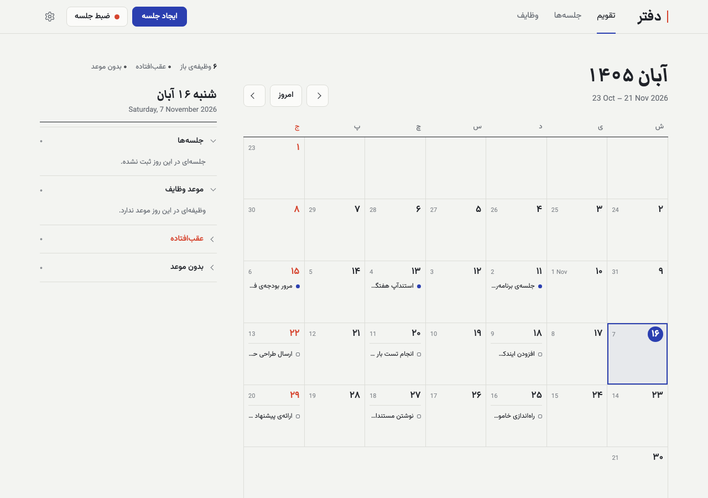
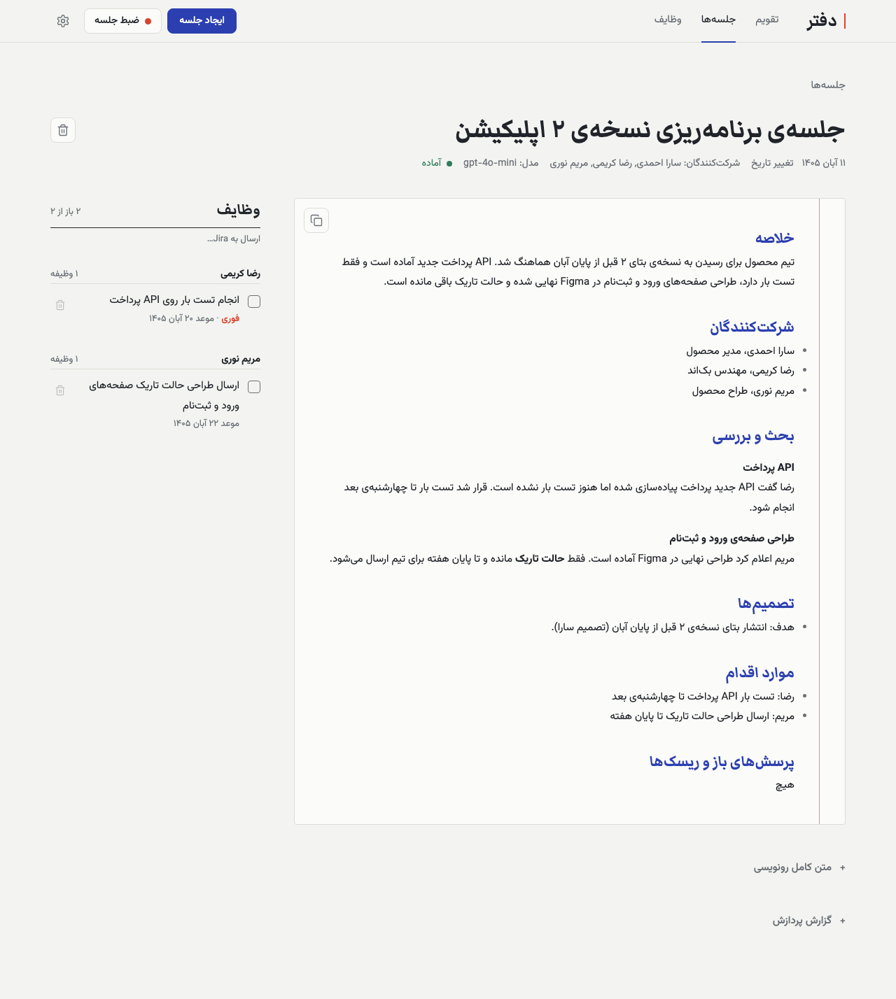
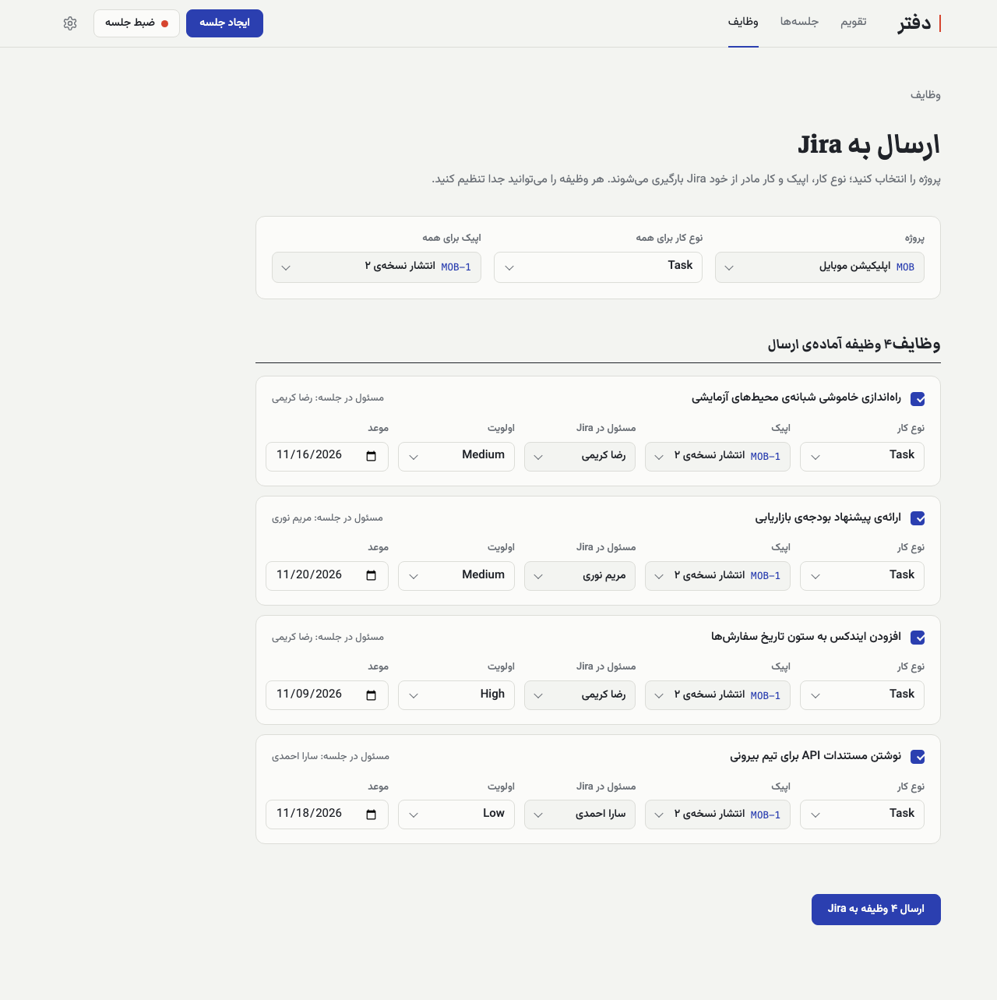
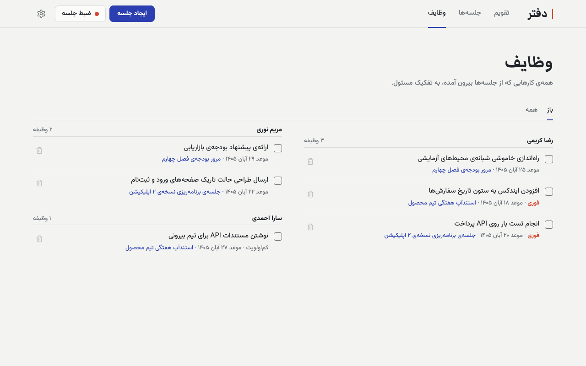
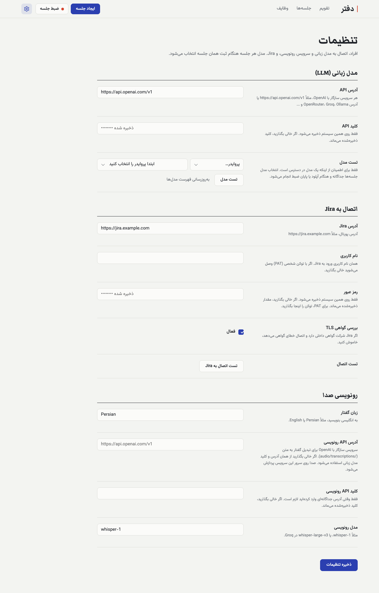
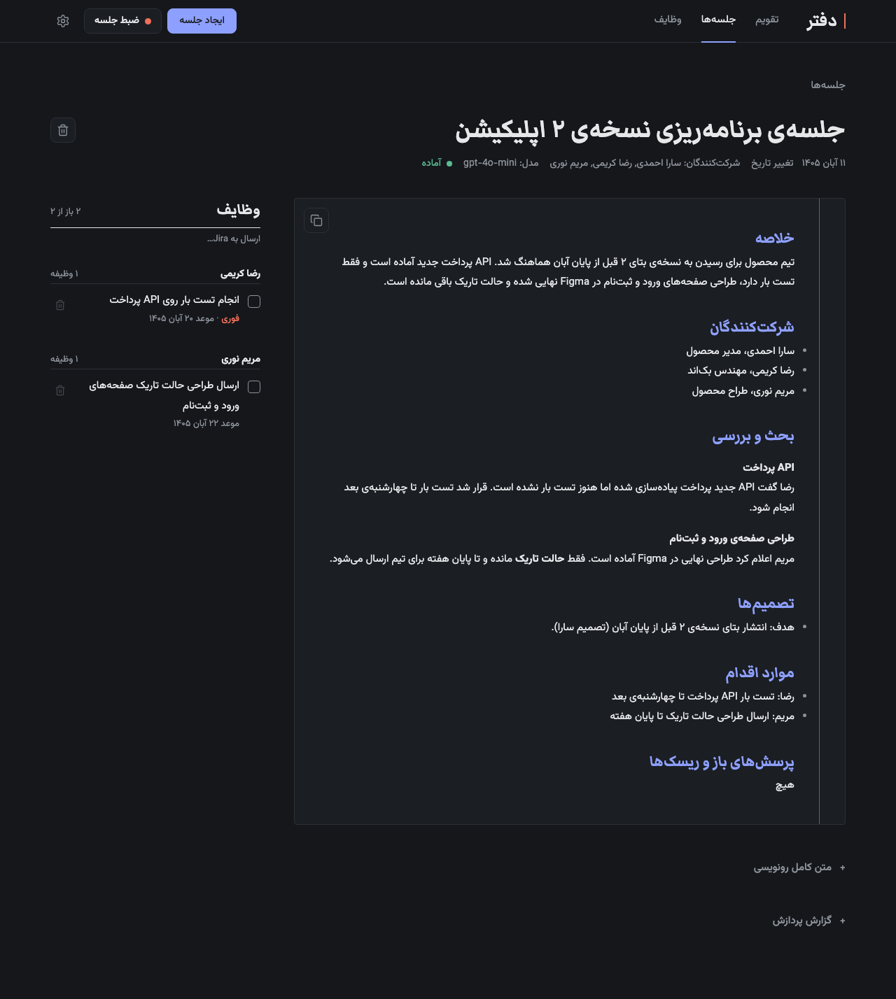
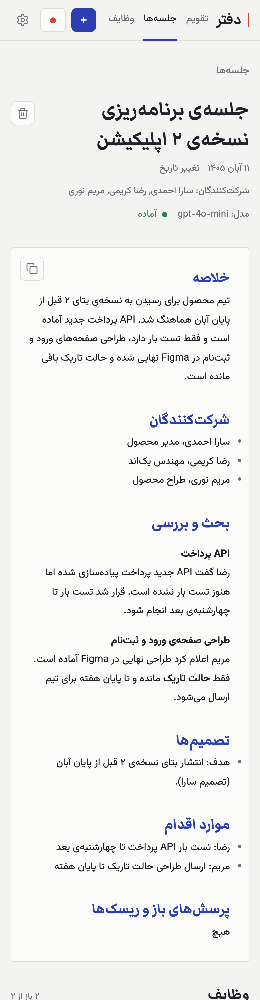

# Daftar (دفتر)

**A self-hosted meeting assistant.** Drop in a recording, or record an in-person meeting from your browser, and Daftar turns it into a transcript, detailed minutes and Jira-style tasks. Tasks land on a Jalali/Gregorian calendar and can be sent to Jira in one go.

English · [فارسی](README.fa.md)

The interface is Persian-first and right-to-left. The transcript and the minutes follow the language of the recording, so other languages work too.



## What it does

- **Audio to transcript.** Upload audio or video, or record from the microphone (the audio streams to the server while you record, so a closed tab loses only a few seconds). Long files are re-encoded, split at pauses, and transcribed part by part. Silent parts are skipped.
- **Minutes and tasks.** A language model writes structured minutes (summary, participants, discussion, decisions, action items, open questions) and extracts tasks as editable tickets with a title, Markdown description, owner, priority and deadline. Relative deadlines such as "next Wednesday" are resolved against the meeting date.
- **People directory.** Teach it nicknames and aliases, so "Sara" becomes "Sara Ahmadi" in minutes and on tasks.
- **Calendar.** Meetings and task deadlines on a Jalali calendar, with Gregorian dates alongside.
- **Send to Jira.** Pick a project; issue types, epics and parent issues load from your Jira (Server / Data Center). Every task can have its own type, epic or parent, assignee, priority and due date. Results are reported per task, and a failed task never blocks the rest.
- **Bring your own providers.** Any OpenAI-compatible API for the language model and for speech to text. Nothing is hard-wired to a vendor.

| Minutes and tasks | Send tasks to Jira |
|---|---|
|  |  |

<details>
<summary>More screenshots: all tasks, settings, dark mode, mobile</summary>







</details>

The screenshots show invented demo meetings.

## Quick start

You need Docker, plus an API key for a language model and for speech to text (one OpenAI key covers both, for example).

```bash
git clone <this repository>
cd daftar
cp .env.example .env     # optional: put your keys here, or enter them in the app later
docker compose up -d --build
```

Open <http://localhost:8787> and go to **Settings** (the gear icon):

1. **Language model**: API address and key, then press "Test model".
2. **Audio transcription**: leave the address empty to use the same provider as the language model, or enter another one. Set the model (`whisper-1` by default) and the spoken language.
3. Optionally add your team under **People**, and your Jira under **Jira**.

Use `localhost` rather than your machine's IP address: browsers only allow microphone access on `localhost` or HTTPS.

Then press "Create meeting" (upload) or "Record", choose a model for that meeting, and wait for the minutes.

### Provider examples

| Purpose | API address | Model |
|---|---|---|
| OpenAI (language model and speech to text) | `https://api.openai.com/v1` | any chat model; `whisper-1` for transcription |
| Groq speech to text | `https://api.groq.com/openai/v1` | `whisper-large-v3` |
| OpenRouter language model | `https://openrouter.ai/api/v1` | any listed model |
| Local Ollama language model | `http://host.docker.internal:11434/v1` | a model you have pulled |
| Local Whisper server | its `/v1` address, for example `http://host.docker.internal:8000/v1` | the model name it serves |

Any server that implements `POST /chat/completions`, `GET /models` and `POST /audio/transcriptions` in the OpenAI format works. When the language model and transcription come from different providers, fill in both sections of Settings. The key of one provider is never sent to the other.

`.env` only provides defaults (`LLM_BASE_URL`, `LLM_API_KEY`, `STT_BASE_URL`, `STT_API_KEY`, `STT_MODEL`). Once you save the Settings page, the saved values win.

## Jira

Daftar talks to Jira Server / Data Center through REST API v2 and writes descriptions in Jira wiki markup. Jira Cloud is not supported yet.

In Settings, enter the Jira address and either a username and password, or leave the username empty and paste a Personal Access Token into the password field. When sending, Daftar creates the issues one by one and never retries a creation automatically, so no duplicate tickets appear. Epics are linked through the Agile API. If your project has required custom fields, Jira's error is shown next to the task.

## Data, privacy and security

- Everything is stored locally in `app-data/` (SQLite, plus the audio while it is being processed; the audio is deleted once its transcript is saved). Back this folder up if the meetings matter: there are no automatic backups.
- **Your audio is sent to your transcription provider, and transcripts are sent to your language-model provider.** Choose providers accordingly, or point both at a local server.
- API keys and the Jira password are stored in the local database. They are never returned by the API and never logged.
- There is **no login**. The container only listens on `127.0.0.1`. Do not expose it to the internet without putting authentication in front of it.
- The browser loads Google Fonts and two small libraries (marked, DOMPurify) from public CDNs.

## Limitations

- Standard transcription APIs do not label speakers, so the transcript has no "Speaker 1 / Speaker 2" lines. The language model uses names and context to attribute statements.
- Each output is generated from the whole transcript in one request, so very long meetings need a model with a large context window.
- Jira Cloud is not supported.

## Development

```bash
docker compose build app
docker compose run --rm --no-deps app python test_app.py
```

The tests run offline: every network call (transcription, language model, Jira) is faked.

| Path | Purpose |
|---|---|
| `app/server.py` | FastAPI routes and the background job pipeline |
| `app/transcribe.py` | audio preparation with ffmpeg, splitting at pauses, OpenAI-compatible transcription client |
| `app/llm.py` | OpenAI-compatible chat client, minutes and task prompts |
| `app/jira.py` | Jira REST v2 client and Markdown to wiki-markup converter |
| `app/people.py`, `app/db.py`, `app/logs.py` | people directory, SQLite and migrations, structured logging |
| `app/static/` | the single-page UI (vanilla JS, no build step) |

Logs are JSON on stdout (`LOG_FORMAT=text` for readable lines). Each line carries a request id and a meeting id, and each meeting's timeline is also shown in the UI.
